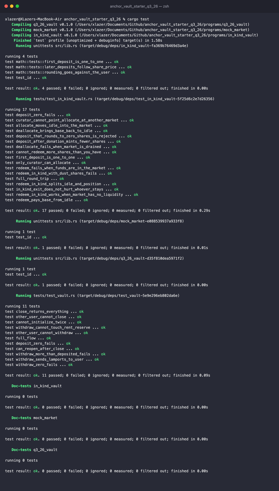

# anchor_vault_starter_q3_26

Vault assignment for Turbine Q3. Started from [moses7054/anchor_vault_starter_q3_26](https://github.com/moses7054/anchor_vault_starter_q3_26).

Three Anchor programs live in this workspace:

| Program | What it is |
|---|---|
| `q3_26_vault` | The SOL vault from the starter, with `withdraw` and `close` added. One vault per user |
| `in_kind_vault` | The advanced extension. A pooled token vault that issues shares, puts deposits to work in a market, and lets anyone exit at any time by redeeming in kind |
| `mock_market` | A very small fake lending market, only there so `in_kind_vault` has a real position to hold |

Anchor 1.1.2, tests in Rust on LiteSVM.

## q3_26_vault

Each user gets two PDAs:

- `vault_state` at `["state", user]`, stores the two bumps
- `vault` at `["vault", user]`, a plain system account that holds the SOL

| Instruction | What it does |
|---|---|
| `initialize` | Creates `vault_state` and sends the rent-exempt minimum into `vault` so the account exists |
| `deposit(amount)` | Moves SOL from the user to the vault |
| `withdraw(amount)` | Moves SOL from the vault back to the user. The vault PDA signs with its seeds. Only what's above the rent-exempt minimum can come out |
| `close` | Sends everything left in the vault to the user and closes `vault_state` (rent goes back to the user too) |

Both PDAs are derived from the signer's key. If someone signs and passes another user's vault accounts, the seeds don't match and Anchor rejects it with `ConstraintSeeds`, so there's no separate owner check needed.

About the rent cap on `withdraw`: my first version allowed withdrawing up to the full balance. Withdrawing down to something like 1 lamport leaves the vault below rent exemption, which the runtime doesn't allow, so the whole tx fails with `InsufficientFundsForRent` instead of an error from the program. Now `withdraw` stops at `balance - rent_exempt` and returns `InsufficientBalance` past that. `close` is how you empty it completely.

Tests (`programs/q3_26_vault/tests/test_vault.rs`, 11 of them): the full initialize → deposit → withdraw → close flow, initializing twice, zero deposit and zero withdraw, withdrawing more than deposited, the rent reserve cap, exact lamport accounting on withdraw and close, another wallet trying to withdraw or close someone else's vault, and reopening a vault after closing it.

## in_kind_vault (advanced extension)

The task: make the vault non-custodial, so users can redeem their position in kind (get the underlying market position) even when the vault has no liquidity, and can exit any time.

### How it works

Users deposit a base token and get vault shares. The curator can move idle base into a market (`mock_market` here, think of a lending pool), and the vault receives the market's receipt tokens. So at any point the vault holds:

- `idle`: base tokens, liquid
- `position`: receipt tokens, a claim on the market

Share price is `(idle + position) / share supply`. Receipts count 1:1 because the mock market doesn't pay interest.

There are two ways out:

- `redeem(shares)` pays base out of idle. Only works if idle covers it.
- `redeem_in_kind(shares)` pays `shares / supply` of the idle base and `shares / supply` of the receipt tokens. It never calls the market, so it works when the market has zero liquidity, and nothing can block it.

After an in-kind exit the user holds the receipt tokens themselves. That's the same claim on the market the vault had, so they can cash out with the market when liquidity comes back, or hold or sell the receipts. `redeem_in_kind_works_when_market_has_no_liquidity` goes through exactly this: everything is lent out, the curator can't unwind, plain redeem fails, the user leaves in kind, and later cashes the receipts with the market directly.

### Why it's non-custodial

- The curator can only call `allocate` and `deallocate`. Both move tokens between the vault's own idle account and its own position in the one market saved at init (`has_one = market`). There's no instruction that sends vault funds to the curator or to any address the curator picks.
- No pause, no withdrawal queue, no admin check on either redeem. A user only needs their own signature.
- The market, mints and token accounts are fixed at init and stored on the vault, every instruction checks against them.
- All the share math rounds down, against whoever is depositing or redeeming. Someone leaving can't take value from the people who stay (`in_kind_exit_does_not_hurt_whoever_stays`).

### Accounts

| Account | Address | Notes |
|---|---|---|
| `vault` | PDA `["vault", curator, base_mint]` | Stores curator, mints, market, idle/position addresses, bumps |
| `share_mint` | PDA `["shares", vault]` | Mint authority is the vault. Same decimals as the base mint |
| `idle` | ATA of `vault` for `base_mint` | |
| `position` | ATA of `vault` for the market's receipt mint | |

### Instructions

| Instruction | Signer | What it does |
|---|---|---|
| `initialize` | curator | Creates the vault, share mint, idle and position accounts for a given market |
| `deposit(amount)` | user | Base in, shares out. First deposit is 1:1, after that `amount * supply / total_assets` |
| `allocate(amount)` | curator | CPI `mock_market::supply`, idle base → market, receipts → position |
| `deallocate(amount)` | curator | CPI `mock_market::withdraw`, receipts → market, base → idle. Fails if the market is drained |
| `redeem(shares)` | user | Burns shares, pays `shares * total_assets / supply` in base from idle |
| `redeem_in_kind(shares)` | user | Burns shares, pays the pro-rata slice of idle base and of receipts |

### Errors

| Code | Name |
|---|---|
| 6000 | `InvalidAmount` |
| 6001 | `MarketMintMismatch` |
| 6002 | `ZeroShares`: deposit too small to mint even one share |
| 6003 | `MathOverflow` |
| 6004 | `NotEnoughIdle`: plain redeem can't be covered, use `redeem_in_kind` |
| 6005 | `NothingToRedeem`: so few shares that both slices round to 0 |

### What I'd change for a real deployment

- Price the position with the market's actual exchange rate. Real receipt tokens (cTokens, LP tokens) grow in value, here they're assumed 1:1.
- Add a virtual shares/assets offset against the first-depositor inflation attack. Right now a deposit that would mint 0 shares is rejected, which stops the worst case (the victim getting nothing), but not smaller rounding grief.
- Support more than one market. `redeem_in_kind` would then pay out a slice of each position.

Tests (`programs/in_kind_vault/tests/test_in_kind_vault.rs`, 17 of them, plus 3 unit tests for the share math in `src/math.rs`): deposits and share pricing (including after a direct donation and the 0-shares case), allocate and deallocate, the curator trying to use another market, non-curators calling allocate, plain redeem with and without enough idle, in-kind redeem with a drained market, the idle/position split, a dust redeem, and a full round trip.

## mock_market

Takes base, mints receipts 1:1 (`supply`), burns receipts and returns base if the pool has it (`withdraw`). The market authority can `borrow` liquidity out, which stands in for borrowers draining the pool, and anyone can `repay`. No interest, no collateral, no checks beyond that. It's a test fixture, not something to deploy.

## Running it

Needs Rust 1.89 (pinned in `rust-toolchain.toml`), the Solana CLI and Anchor 1.1.2.

```bash
anchor build --ignore-keys
cargo test
```

Without `--ignore-keys` anchor prints a "Program ID mismatch" warning. That's because program keypairs live in `target/deploy` (gitignored), so a fresh clone generates new ones that don't match the IDs in `declare_id!`, and `q3_26_vault`'s ID comes from the starter anyway. It still builds. LiteSVM loads each program at the ID in `declare_id!`, so the mismatch doesn't matter for tests. Don't run `anchor keys sync` unless you mean to change the IDs.

If `anchor --version` isn't 1.1.2, run `avm use 1.1.2` or call `~/.avm/bin/anchor-1.1.2` directly.

The tests read the compiled programs from `target/deploy/*.so`, so always build before `cargo test`.



## Layout

```
programs/
├── q3_26_vault/
│   ├── src/instructions/{initialize,deposit,withdraw,close}.rs
│   └── tests/test_vault.rs
├── in_kind_vault/
│   ├── src/
│   │   ├── math.rs
│   │   ├── state.rs
│   │   └── instructions/{initialize,deposit,rebalance,redeem}.rs
│   └── tests/test_in_kind_vault.rs
└── mock_market/
    └── src/lib.rs
```
